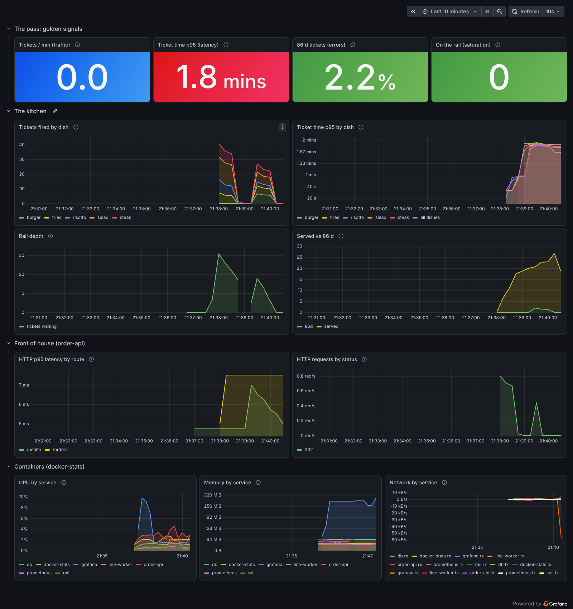
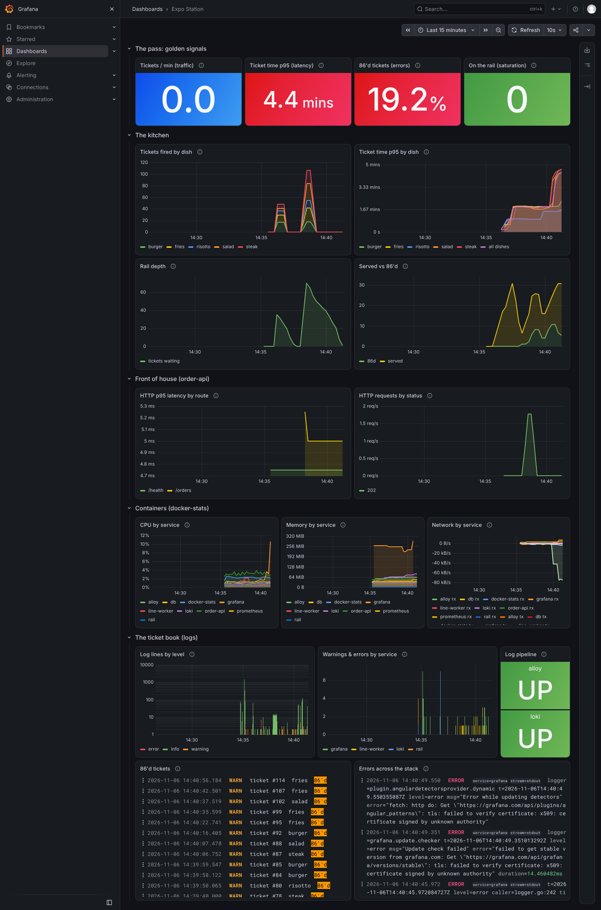
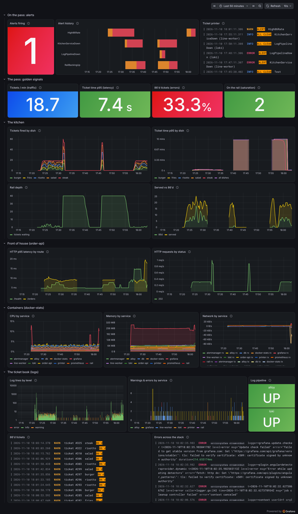

# Expo Station

A Docker observability project. A small "kitchen" app takes orders and cooks them; a monitoring
stack (Prometheus, Grafana, Loki, Alloy, Alertmanager) watches it the way an expo cook watches the pass.

Eleven containers, one `docker compose up`. Metrics, logs and alerts are all config in this repo:
nothing is clicked together in a UI.

## Phase 1: the kitchen

| Service | Role | Kitchen term |
|---|---|---|
| `order-api` | FastAPI app that takes orders, `/metrics` on :8000 | Front of house |
| `line-worker` | Pulls tickets off the queue and cooks them, `/metrics` on :9100 | The line |
| `rail` | Redis list holding pending tickets | Ticket rail |
| `db` | Postgres, stores every ticket | The pantry / ticket book |

## Run it

```bash
cp .env.example .env
openssl rand -base64 24 | tr -d '\n' > secrets/db_password.txt
docker compose up -d --build
docker compose ps          # all four should reach (healthy)
./scripts/fire-orders.sh 20
```

- API docs: http://localhost:8000/docs
- App metrics: http://localhost:8000/metrics
- Live-reload while coding: `docker compose watch`

## Phase 2: the expo station (metrics)



| Service | Role | URL |
|---|---|---|
| `prometheus` | Scrapes every target every 15s, stores 7 days, runs recording rules | http://localhost:9090 |
| `docker-stats` | Per-container CPU, memory, network via the Docker API (our own exporter) | internal :9417 |
| `grafana` | "Expo Station" dashboard, provisioned from this repo | http://localhost:3000 |

```bash
openssl rand -base64 18 | tr -d '\n' > secrets/grafana_admin_password.txt
docker compose up -d --build
cat secrets/grafana_admin_password.txt   # log in to Grafana as admin with this
```

Check every scrape target is `UP`: http://localhost:9090/targets

### Everything is code

- `prometheus/prometheus.yml`: scrape jobs
- `prometheus/rules/kitchen.rules.yml`: recording rules (p95 ticket time, 86 ratio, etc.)
- `grafana/provisioning/`: datasource and dashboard provider
- `grafana/dashboards/expo-station.json`: the dashboard itself. Edits made in the UI won't save;
  change the JSON (or export from the UI and commit it).

### Lessons from building it

- **cAdvisor doesn't work on Docker Desktop with Docker 29.** cAdvisor 0.60 needs the
  containerd socket even in Docker mode, and Docker Desktop only exposes `docker.sock` to
  containers. On native Linux, `--containerd=<socket> --containerd-namespace=moby` fixes it
  (Docker 29 keeps containers in containerd's `moby` namespace). On Desktop there is no socket
  to point at, so `exporters/docker-stats/` reads the Docker API instead and publishes the
  same metric names cAdvisor uses, so the dashboard didn't change.
- **cAdvisor moved registries.** `gcr.io/cadvisor` stopped updating Dec 2025; use `ghcr.io/google/cadvisor`.
- **Histogram buckets can lie.** p95 ticket time flatlined at exactly 60s, the top bucket,
  while real tickets waited minutes. The top bucket must exceed the worst real value.
- **A counter label doesn't exist until it's incremented.** With no 86'd tickets yet, the
  error-ratio query returned nothing instead of 0%. Pre-create every label combination at 0.
- **"No data" isn't "zero".** p95 latency showed a green `0` when nothing was being served.
  Panels now say "No tickets" when there's no data instead of faking a perfect score.
- **Healthchecks look like traffic.** Docker hits `/health` every 10s (0.1 req/s). The traffic
  panel excludes it so it shows customers only.

### Security note

`docker-stats` and `alloy` mount `/var/run/docker.sock`. That is root-equivalent access to Docker even
when mounted `:ro` (read-only blocks file writes, not API calls). Acceptable for a local lab;
in anything shared, put a read-only Docker socket proxy in front of it.

## Phase 3: the ticket book (logs)

| Service | Role | URL |
|---|---|---|
| `alloy` | Finds this project's containers via the Docker API, tails their logs, parses them, ships to Loki | http://localhost:12345 (live pipeline graph) |
| `loki` | Stores and indexes log lines, 7-day retention | http://localhost:3100 (API) |

```bash
docker compose up -d --build
./scripts/fire-orders.sh 40
```

The dashboard has a new row, **The ticket book (logs)**: log volume by level, warnings and errors
by service, a live feed of 86'd tickets, every error across the stack, and a Loki/Alloy health stat.
Explore (compass icon in Grafana) takes any LogQL query.



### Labels vs structured metadata

| Field | Stored as | Why |
|---|---|---|
| `service`, `project`, `stream` | Label | From Docker/Compose metadata; a handful of values each |
| `level` | Label | Normalised to `info` / `warning` / `error` across every service |
| `dish` | Label | Five values (the menu) |
| `order_id` | Structured metadata | One value per ticket. As a label it would create a new stream per ticket and blow up Loki's index |

Follow one ticket from front of house to the line:

```logql
{service=~"order-api|line-worker"} | order_id="7"
```

### Useful queries

```logql
{service="line-worker"} |= "86'd"                                  # every failed ticket
{project="expo-station", level="error"}                            # every error, any service
sum by (dish) (count_over_time({service="line-worker"} |= "86'd" [5m]))   # 86s by dish
{service="line-worker"} | json | ticket_time_s > 60                # tickets that waited over a minute
```

### Lessons from building it

- **Every service logs differently.** JSON (kitchen), logfmt (Grafana, Loki, Alloy, Prometheus),
  `LOG:/ERROR:` (Postgres), and Redis uses a *symbol* (`#` = warning). A first attempt that searched
  every line for the word "error" tagged Redis's `bf-error-rate` config setting as an error. Each
  service now gets its own parser via `stage.match`, and they all write one shared `level`.
- **Healthchecks look like traffic, in logs too.** uvicorn logged every `/health` probe and
  `/metrics` scrape, about 10 lines a minute of nothing. Alloy drops them, and counts how many in
  `loki_process_dropped_lines_total{reason="probe_noise"}`.
- **You can't healthcheck a distroless image from inside.** The Loki image has no shell, `wget` or
  `curl`. Instead Prometheus scrapes Loki, and `up{job="loki"}` is the health signal. Alloy's image has
  `bash` but no `curl`, so its healthcheck uses bash's built-in `/dev/tcp` to send a raw HTTP request.
- **docker.sock again, not log files.** On Docker Desktop, `/var/lib/docker/containers` lives
  inside the WSL2 VM, out of reach of a bind mount from Windows. `loki.source.docker` reads logs
  through the Docker API, so the same config works on Desktop and native Linux.
- **One loud service can hide everything.** Grafana writes ~1,000 migration lines on first boot,
  flattening the log-volume chart. That panel uses a log-scale axis so errors stay visible.
- **Not every `level=error` is a problem.** Loki logs `context canceled` at error level whenever a
  query is abandoned (a dashboard refresh, a closed tab). Knowing which errors are noise is the job.
- **Retention is off by default.** Loki ignores `retention_period` unless the compactor has
  `retention_enabled: true`. Without it, logs grow forever.
- **Turn off what you don't use.** Grafana downloads several app plugins at every boot.
  `GF_PLUGINS_PREINSTALL_DISABLED=true` stops it; empty `provisioning/plugins` and
  `provisioning/alerting` folders stop the "can't read provisioning directory" errors.

## Phase 4: calling it out (alerts)

| Service | Role | URL |
|---|---|---|
| `alertmanager` | Groups, deduplicates, inhibits and routes alerts from Prometheus | http://localhost:9093 |
| `printer` | Webhook receiver: prints every alert and "all clear" as a JSON log line, so alerts land in Loki | internal :9095 |

```bash
docker compose up -d --build
```

The dashboard opens with a new top row, **On the pass: alerts**: how many alerts are firing,
a pending/firing history per alert, and the ticket printer feed (what Alertmanager actually sent).



### The alerts

| Alert | Fires when | `for` | Severity |
|---|---|---|---|
| `High86Rate` | Over 10% of tickets 86'd, **and** more than 2 tickets/min finishing | 2m | warning |
| `RailBackingUp` | Over 20 tickets on the rail, **and** not shrinking | 5m | warning |
| `KitchenServiceDown` | Prometheus can't scrape `order-api` or `line-worker` | 1m | critical |
| `LogPipelineDown` | Prometheus can't scrape Loki or Alloy | 1m | critical |

**Inhibition:** while `KitchenServiceDown` is firing for `line-worker`, `RailBackingUp` is held
back. A stopped line always backs up the rail; you want to hear about the cause, not the symptom.

### Make them fire

```bash
# High86Rate: a bad line at normal traffic (fires after ~2-3 minutes)
FAIL_RATE=0.4 docker compose up -d line-worker
./scripts/fire-orders.sh 120 3.2

# KitchenServiceDown (and RailBackingUp, inhibited): stop the line, keep ordering
docker compose stop line-worker && ./scripts/fire-orders.sh 40 0.2

# LogPipelineDown
docker compose stop loki

# Put everything back
docker compose up -d
```

Watch it in Prometheus (http://localhost:9090/alerts), Alertmanager (http://localhost:9093,
inhibited alerts show under "Inhibited"), and the dashboard's top row.

### Alert rules have unit tests

`prometheus/tests/alerts.test.yml` feeds made-up metric history through the real rules and checks
which alerts fire, including the cases that *shouldn't* fire:

```bash
docker compose run --rm --no-deps --entrypoint promtool prometheus test rules /etc/prometheus/tests/alerts.test.yml
```

### Lessons from building it

- **Ratios lie at low volume.** One failed ticket out of one is a "100% error rate". `High86Rate`
  has a traffic floor (more than 2 tickets a minute), and a unit test proves it stays quiet at
  3am volume. Removing the floor makes that test fail, so the test is really guarding something.
- **Alerts can fire after the fix.** With a stopped `line-worker`, inhibition held back
  `RailBackingUp`. But when the worker came back, the inhibition lifted while the rail was
  still deep, so it paged a full minute *after* the problem was solved, while the rail was
  visibly draining. "Backing up" should mean deep **and not shrinking**, so the rule now
  includes `deriv(kitchen_rail_depth[2m]) >= 0`. Re-running the same outage: no page. A unit
  test covers the draining case.
- **Page on causes, not symptoms.** Inhibition rules encode "if A is true, B is expected".
  In the test outage, Prometheus fired `RailBackingUp` and Alertmanager held it back; the history
  panel shows it red while the printer feed never mentions it.
- **"All clear" messages keep stale numbers.** Alertmanager resends the annotations from when the
  alert fired, so a resolved ticket read *"ALL CLEAR … 86'ing 30.77% of tickets"*. The printer
  labels it `"was"` instead of `"summary"` on resolve.
- **Alerts survive a log outage.** The `LogPipelineDown` ticket was printed while Loki was down.
  Alloy held it and retried, and it reached Loki once Loki came back.
- **The pipeline monitors itself.** `LogPipelineDown` is the healthcheck Loki can't have (distroless
  image, no shell). Prometheus watching Loki closes the loop from Phase 3.
- **Get real notifications by changing one file.** The printer is a stand-in. Add a Discord, Slack
  or email receiver in `alertmanager/alertmanager.yml` and point the route at it; nothing else changes.

## Metrics exposed

| Metric | Type | Signal |
|---|---|---|
| `expo_http_request_duration_seconds` | histogram | Latency |
| `expo_http_requests_total` | counter | Traffic / errors |
| `kitchen_tickets_fired_total` | counter | Traffic |
| `kitchen_tickets_cooked_total{outcome="86d"}` | counter | Errors |
| `kitchen_ticket_time_seconds` | histogram | Latency (end to end) |
| `kitchen_rail_depth` | gauge | Saturation |
